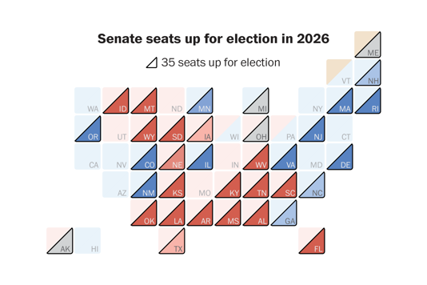

# Pràctica 1 MiV: Desmuntant la mentida visual
En aquesta pràctica s'evalua un plot poc adient trobat per Internet, que viola principis de Gestalt i Tufte de manera no intencionada, fent que el resultat final sigui un gràfic poc entenible.

## Plot original

Aquest plot presenta diversos problemes comentats a la documentació de la pràctica.

## Correccions
En aquest codi es troba tot el codi per adquisició, preprocessament i disposició de dades finals en un plot corregit. Els detalls dels preprocessaments, les decisions de disseny del nou plot i implementació de la interactivitat queden en la documentació de la pràctica.

## Set-up
L'aplicació funciona en Python. Hi ha 2 directoris:
- data-fetching: Projecte per obtenir les dades de la Wikipedia sobre informació actual i enquestes sobre el senat dels EUA.
- plotting: Projecte per crear la nova visualització.

En ambós casos, s'inclou un fitxer `requirements.txt` per fer el set-up de les dependències. Recomanem l'eina `uv` per crear entorns virtuals.