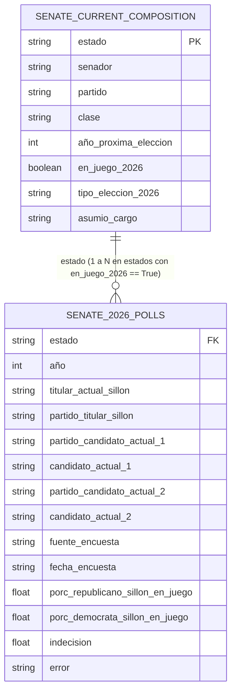

# Esquema de Datos — Elecciones al Senado de EE. UU. 2026

Este documento detalla la estructura, formato, tipado y significado de cada uno de los campos de los dos archivos CSV generados para la **Práctica 1 de MiV (Visualización de Información)**:

1. [`senate_current_composition.csv`](file:///Users/ivanmolineromoreno/DatosUNI/4t_curso/MiV/practica-1/info-sources/senate_current_composition.csv): Composición actual del Senado de los Estados Unidos (100 senadores en funciones, 2 por estado).
2. [`senate_2026_polls.csv`](file:///Users/ivanmolineromoreno/DatosUNI/4t_curso/MiV/practica-1/info-sources/senate_2026_polls.csv): Registro granular de sondeos e intención de voto para los 35 escaños en juego en 2026.

---

## 1. Archivo: `senate_current_composition.csv`

### Propósito y Contexto
Según el **Artículo I, Sección 3 de la Constitución de los EE. UU.**, cada estado cuenta con exactamente 2 senadores cuyos mandatos de 6 años están escalonados en tres Clases (Clase 1, 2 y 3). 

Este archivo proporciona la **foto fija completa del Senado (100 escaños)**. Sirve de línea base para contrastar los 65 escaños asegurados (que no se someten a votación en 2026) frente a los 35 escaños que se disputan.

### Diccionario de Campos (8 columnas)

| Campo | Tipo de Dato | Nulable | Valores Posibles / Formato | Descripción |
| :--- | :--- | :---: | :--- | :--- |
| `estado` | `string` | No | Nombres de los 50 estados de EE. UU. (ej. `Alabama`, `California`, `Texas`) | Estado federado representado por el senador. Cada estado aparece exactamente dos veces (100 filas en total). |
| `senador` | `string` | No | Texto libre (ej. `Tommy Tuberville`, `Katie Britt`, `Alex Padilla`) | Nombre y apellidos del senador actualmente en el cargo. |
| `partido` | `string` | No | `REP`, `DEM`, `IND`, `OTH` | Partido político al que pertenece el senador en la actualidad. |
| `clase` | `string` | No | `Clase 1`, `Clase 2`, `Clase 3` | Clase constitucional del escaño. Determina el ciclo bienal de renovación ordinaria. |
| `año_proxima_eleccion` | `integer` | No | `2026`, `2028`, `2030` | Año en que expira el mandato ordinario de 6 años para esta banca. |
| `en_juego_2026` | `boolean` | No | `True`, `False` | Indica si el escaño se somete a elección en noviembre de 2026. Hay exactamente 35 registros con valor `True` y 65 con `False`. |
| `tipo_eleccion_2026` | `string` | No | `Regular (Clase 2)`, `Especial (Clase 3)`, `No aplicable` | Naturaleza de la elección en el ciclo 2026: <br>• `Regular (Clase 2)`: 33 escaños ordinarios de Clase 2.<br>• `Especial (Clase 3)`: 2 elecciones extraordinarias por vacante anticipada (Florida por renuncia de Marco Rubio y Ohio por renuncia de JD Vance).<br>• `No aplicable`: 65 escaños que no se votan este año. |
| `asumio_cargo` | `string` | No | Fecha en formato texto en inglés (ej. `"January 3, 2021"`) | Fecha oficial de juramento o toma de posesión del senador. |

### Ejemplo de Registros

```csv
estado,senador,partido,clase,año_proxima_eleccion,en_juego_2026,tipo_eleccion_2026,asumio_cargo
Alabama,Tommy Tuberville,REP,Clase 2,2026,True,Regular (Clase 2),"January 3, 2021"
Alabama,Katie Britt,REP,Clase 3,2028,False,No aplicable,"January 3, 2023"
Florida,Rick Scott,REP,Clase 1,2030,False,No aplicable,"January 8, 2019"
Florida,Ashley Moody,REP,Clase 3,2026,True,Especial (Clase 3),"January 21, 2025"
Georgia,Jon Ossoff,DEM,Clase 2,2026,True,Regular (Clase 2),"January 20, 2021"
Georgia,Raphael Warnock,DEM,Clase 3,2028,False,No aplicable,"January 20, 2021"
```

---

## 2. Archivo: `senate_2026_polls.csv`

### Propósito y Contexto
Almacena el desglose detallado de todos los sondeos y estimaciones de intención de voto para las **35 carreras al Senado activas en 2026** (33 de Clase 2 + 2 especiales). 

Permite analizar la dinámica electoral estado por estado, evaluar la evolución temporal mediante la fecha del sondeo, contrastar el titular defensor del escaño frente a los nuevos aspirantes, y detectar posibles vuelcos de mayoría (*flips*).

### Diccionario de Campos (14 columnas)

| Campo | Tipo de Dato | Nulable | Valores Posibles / Formato | Descripción |
| :--- | :--- | :---: | :--- | :--- |
| `estado` | `string` | No | Nombres de los 35 estados con comicios (ej. `Georgia`, `Michigan`, `Florida`) | Estado federado donde se celebra la contienda electoral de 2026. |
| `año` | `integer` | No | `2026` | Año del ciclo electoral al Senado analizado. |
| `titular_actual_sillon` | `string` | Sí | Nombre del senador (ej. `Jon Ossoff`, `Tommy Tuberville`, `Dan Sullivan`) | Nombre del senador que ocupa o defendía el escaño antes de las elecciones de 2026. |
| `partido_titular_sillon` | `string` | Sí | `REP`, `DEM` | Partido político que defiende el escaño. Fundamental para calcular si un resultado proyecta continuidad o un vuelco de partido (*flip*). |
| `partido_candidato_actual_1` | `string` | Sí | `REP`, `DEM`, `IND`, `OTH` | Partido político del primer candidato nominado/principal para la elección 2026. |
| `candidato_actual_1` | `string` | Sí | Nombre y apellidos limpios (ej. `Jon Ossoff`, `Barry Moore`, `Ashley Hinson`) | Nombre del primer candidato que se postula en 2026. |
| `partido_candidato_actual_2` | `string` | Sí | `REP`, `DEM`, `IND`, `OTH` | Partido político del segundo candidato nominado/principal para la elección 2026. |
| `candidato_actual_2` | `string` | Sí | Nombre y apellidos limpios (ej. `Mike Collins`, `Everett Wess`, `Josh Turek`) | Nombre del segundo candidato que se postula en 2026. |
| `fuente_encuesta` | `string` | Sí | Nombre de la firma demoscópica o agregador (ej. `YouGov`, `Siena College`, `RealClearPolitics`, `Emerson College`, `Decision Desk HQ`) | Empresa o medio de comunicación responsable de la publicación o elaboración de la encuesta. Nulo si el estado carece de sondeos publicados. |
| `fecha_encuesta` | `string` | Sí | Rango o fecha en inglés (ej. `"September 15–18, 2026"`, `"April 18 – May 17, 2026"`) | Ventana temporal durante la cual se realizó el trabajo de campo de la encuesta. |
| `porc_republicano_sillon_en_juego` | `float` | Sí | Rango de 0.0 a 100.0 (ej. `47.0`, `48.3`) | Porcentaje estimado de intención de voto para el candidato del Partido Republicano. Nulo si el sondeo no midió al candidato republicano o si no hay sondeos. |
| `porc_democrata_sillon_en_juego` | `float` | Sí | Rango de 0.0 a 100.0 (ej. `32.0`, `50.0`) | Porcentaje estimado de intención de voto para el candidato del Partido Demócrata. Nulo si el sondeo no midió al candidato demócrata o si no hay sondeos. |
| `indecision` | `float` | Sí | Rango de 0.0 a 100.0 (ej. `1.0`, `8.7`) | Porcentaje de encuestados indecisos, votantes de terceros partidos o respuestas "No sabe / No contesta" (*DK/Undecided*). Nulo cuando la encuestadora no desglosó esta categoría. |
| `error` | `string` | Sí | Mensajes explicativos controlados o vacío/nulo | Indica por qué un estado carece de datos de encuestas o candidatos. Permanece vacío (`None`) en todas las filas que contienen sondeos válidos. <br>• `"No general election polling data found on page"`: Escaños no competitivos (*safe seats*) sin encuestas en Wikipedia.<br>• `"Candidates/nominees not yet identified on Wikipedia"`: Candidaturas pendientes.<br>• `"Polling tables found but could not extract candidate percentages"`: Tablas de sondeos sin desglose numérico compatible. |

### Ejemplo de Registros

```csv
estado,año,titular_actual_sillon,partido_titular_sillon,partido_candidato_actual_1,candidato_actual_1,partido_candidato_actual_2,candidato_actual_2,fuente_encuesta,fecha_encuesta,porc_republicano_sillon_en_juego,porc_democrata_sillon_en_juego,indecision,error
Alabama,2026,Tommy Tuberville,REP,REP,Barry Moore,DEM,Everett Wess,yes. every kid.,"July 8–11, 2026",47.0,32.0,1.0,
Alaska,2026,Dan Sullivan,REP,REP,Dan S. Sullivan,DEM,Mary Peltola,RealClearPolitics,"August 20 – September 17, 2026",48.3,50.0,1.7,
Georgia,2026,Jon Ossoff,DEM,DEM,Jon Ossoff,REP,Mike Collins,InsiderAdvantage (R),"June 15, 2026",42.0,45.0,2.0,
Delaware,2026,Chris Coons,DEM,DEM,Chris Coons,REP,Michael Katz,,,,,,No general election polling data found on page
Florida,2026,Ashley Moody,REP,REP,Ashley Moody,DEM,Angie Nixon,270toWin,"September 11–24, 2026",48.8,42.5,8.7,
```

---

## 3. Relación e Integración entre Conjuntos de Datos

Ambos conjuntos de datos están diseñados para ser vinculados en visualizaciones relacionales mediante el atributo común **`estado`**:



### Casos de Uso en la Visualización:
1. **Mapa / Tile Map del Senado Completo (100 escaños):** Permite colorear los 65 escaños que **no cambian** con el color de su partido actual (`partido` en `senate_current_composition.csv`), y resaltar los 35 escaños **en juego** usando las medias ponderadas de intención de voto de `senate_2026_polls.csv`.
2. **Detección de Vuelcos de Mayoría (*Flips*):** Al comparar `partido_titular_sillon` con el candidato que lidera (`porc_republicano_sillon_en_juego` vs. `porc_democrata_sillon_en_juego`), se identifica de inmediato si un escaño se mantendría (*Hold*) o cambiaría de signo político (*Flip*).
3. **Análisis Temporal y Metodológico:** Permite trazar la evolución de la ventaja demócrata/republicana en el tiempo (`fecha_encuesta`) y filtrar por el rigor o tipo de fuente (`fuente_encuesta`).
